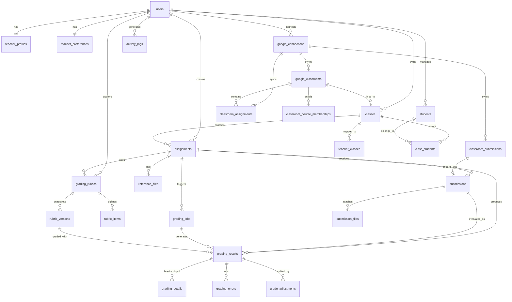

# Excel Auto Grader - Entity Relationship Diagram (Multi-Teacher SaaS)

ระบบฐานข้อมูลออกแบบด้วยหลัก **Multi-Tenant Row Level Security (RLS)** โดยทุกตารางที่เก็บข้อมูลของครูจะมีคอลัมน์ `owner_user_id` (UUID) เพื่อแยกข้อมูลของครูแต่ละคนอย่างเด็ดขาด และใช้ Composite Unique Constraints สำหรับข้อมูลจากหลายบัญชี Google Classroom

## สรุปตารางหลัก (23 ตาราง)

| กลุ่ม | ตาราง | หน้าที่หลัก |
|---|---|---|
| ผู้ใช้และครู | `users`, `teacher_profiles`, `teacher_preferences` | บัญชีครู เชื่อม Supabase Auth และตั้งค่าส่วนตัว |
| Google Multi-Account | `google_connections`, `google_classrooms`, `classroom_course_memberships`, `classroom_assignments`, `classroom_submissions` | รองรับหลายบัญชี Google ต่อครู 1 คน พร้อม Composite Unique Constraints |
| ชั้นเรียนและนักเรียน | `classes`, `teacher_classes`, `students`, `class_students` | จัดการห้องเรียน รายชื่อนักเรียน การย้ายห้อง |
| งานและเกณฑ์ตรวจ | `assignments`, `reference_files`, `grading_rubrics`, `rubric_items`, `rubric_versions` | งาน ไฟล์เฉลย เกณฑ์ละเอียด 7 หมวด และเวอร์ชันเกณฑ์ |
| การส่งงานและตรวจ | `submissions`, `submission_files`, `grading_jobs`, `grading_results`, `grading_details`, `grading_errors`, `grade_adjustments` | ไฟล์งาน คิวตรวจ ผลคะแนน หลักฐานข้อผิดพลาด และประวัติแก้คะแนน |
| Audit | `activity_logs` | บันทึกการใช้งานระบบทุกขั้นตอน |

## โครงสร้าง Supabase Storage (Private Bucket)
- `/users/{user_id}/references/` — ไฟล์ Excel ต้นฉบับเฉลย
- `/users/{user_id}/submissions/` — ไฟล์ Excel ที่นักเรียนส่ง
- `/users/{user_id}/reports/` — รายงาน PDF รายบุคคลและรายห้อง
- `/users/{user_id}/exports/` — ไฟล์ส่งออกคะแนน Excel / CSV
